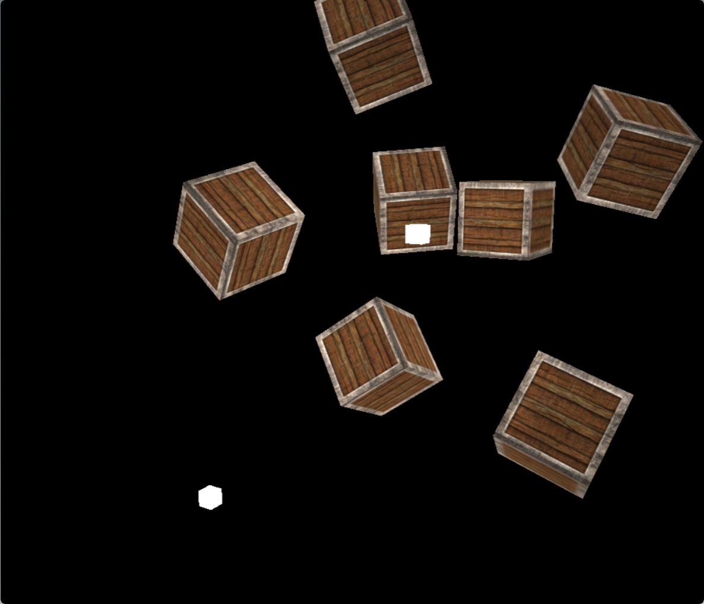
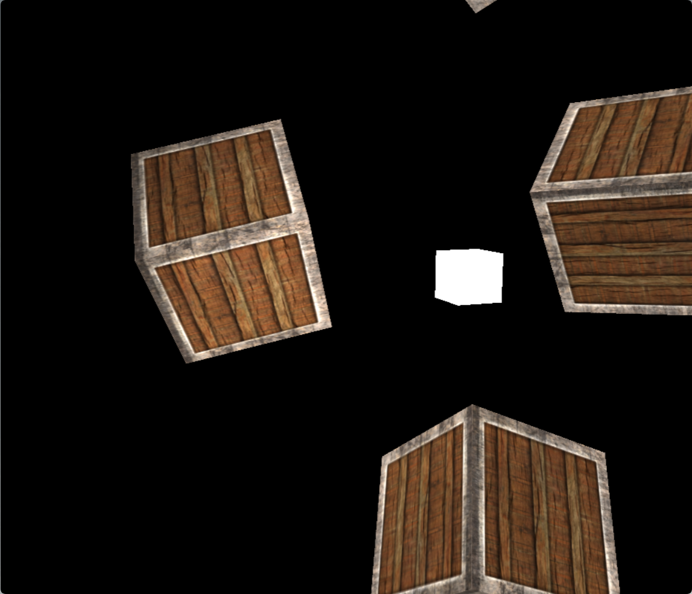
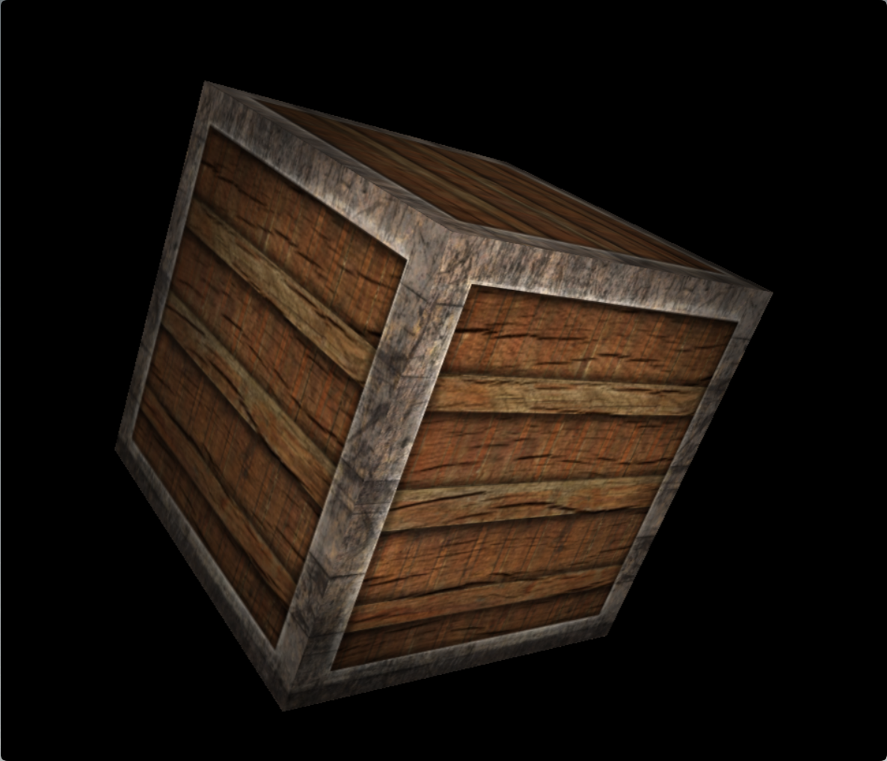

# sdl3-opengl-engine
A minimal engine built using SDL3, OpenGL ES and GLM, mainly for learning purposes. Everything i've implemented here was learned from [learnopengl.com](https://learnopengl.com/). But instead of using GLFW, my version is built using SDL3, has more abstractions, uses C++ smart pointers, and uses meson as the build tool.

## Screenshots



| Scene detail with a point light source | Close-up of a textured cube |
| --- | --- |
|  |  |

## Building

Requires Meson, Ninja, a C++23 compiler, and development packages for SDL3 (>= 3.2) and OpenGL ES (>= 3.1).

```sh
meson setup build
ninja -C build
./build/SDL\ Project
```

## License

All code except the dependencies under `external/` (GLM and stb_image) is licensed under CC0 1.0, the full text of which is provided in [LICENSE](LICENSE).

All textures under `assets/textures/` are taken from [learnopengl.com](https://learnopengl.com/), authored by Joey de Vries ([@JoeyDeVriez](https://twitter.com/JoeyDeVriez)), and are licensed under the [Creative Commons Attribution 4.0 International License](https://creativecommons.org/licenses/by/4.0/legalcode).